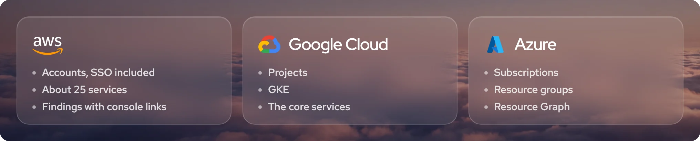

  

  <b>See your clouds without leaving AI Bridge.</b> 
  What's running, what it costs and what's worth fixing, in the same window as your agents.

  &nbsp;&nbsp;

  In development · tested on real accounts · read-only by design

 

## The first three

  

**AWS.** Every account in one home, SSO included, with favourites and real account names. About 25 services, from EC2, EKS and Lambda to S3, IAM, RDS and Route 53.

**Google Cloud.** Your projects, GKE and the core services.

**Azure.** Subscriptions and resource groups, read through Resource Graph.

## What you get

🔎 **What's worth fixing.** Unused NAT gateways, unhealthy targets, access keys nobody has rotated. Each finding links straight to the right page in the console.

💰 **Costs without surprises.** Free cost data wherever the provider offers it. Where a lookup is billed, like AWS Cost Explorer, AI Bridge shows the most it could cost and asks first. One click, one fetch, nothing on a schedule.

🤖 **A second opinion from your own AI.** Your Claude Code or Codex reads a privacy-filtered snapshot and writes a report: what it found, a cost estimate, and commands ready to copy or run in AI Bridge's terminal.

⚡ **Quick on big organisations.** Your home region loads first, blocked regions are spotted fast, and the counts fill in as they arrive.

## Safe by design

A plugin describes what it wants to see. AI Bridge does the reading.

- **Your credentials stay yours.** Plugins never see them.
- **Only where it says it goes.** A plugin can reach the hosts it declares, and nothing else.
- **Read-only.** Plugins look. They don't change anything.
- **Personal data is masked** before it reaches a plugin or the AI, unless you choose otherwise.

## What's coming

1. A plugin installer, with signed plugins.
2. A published SDK, so anyone can build one.
3. AWS, Google Cloud and Azure, released here as the first official plugins.

To hear when each one lands: **Watch › Custom › Releases** at the top of this page.

## Build your own

The SDK isn't public yet. In the meantime, tell us what you'd want inside AI Bridge: a hosting provider, a CI service, an observability tool, anything with an API or a CLI. [Suggest a plugin](../../issues/new?template=plugin-idea.yml), and give a 👍 to the ideas you'd use. They decide what comes after the clouds.

## About AI Bridge

[AI Bridge](https://aibridge.sh/?src=gh-plugins) is a Mac app that runs Claude Code, Codex, Grok and OpenCode side by side, organised like a team. It's free to start. Releases and bug reports live in [aibridge-sh/bridge](https://github.com/aibridge-sh/bridge).

 

  Made by CyberNucleus Pty Ltd, trading as AI Bridge sh.

